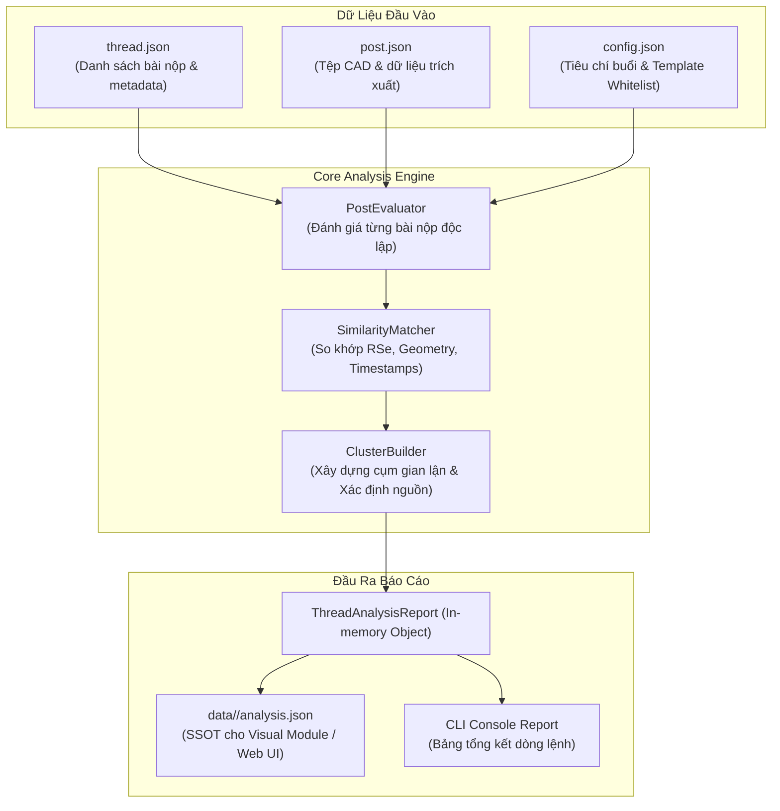

# HƯỚNG DẪN MODULE PHÂN TÍCH & PHÁT HIỆN GIAN LẬN (ANALYSIS MODULE)

Tài liệu hướng dẫn chi tiết về Module Phân tích dữ liệu CAD, cơ chế so khớp chéo đa chiều (Forensic Cross-Matching), cấu trúc file báo cáo `analysis.json` và cách tích hợp với Module Trực quan hóa (Visual Dashboard / Web UI).

---

## 1. TỔNG QUAN KIẾN TRÚC

Module Analysis (`src/analysis/`) hoạt động độc lập với tầng thu thập dữ liệu (Preparation), đóng vai trò phân tích học tập và kiểm tra liêm chính học thuật (Academic Integrity / Anti-Plagiarism).



---

## 2. NGUYÊN LÝ SO KHỚP FORENSIC CAD

Hệ thống dựa trên đặc tả kỹ thuật tại [`docs/cad-metadata-specification.md`](file:///home/vuquan/dev/4C-checker/docs/cad-metadata-specification.md):

1. **RSe Storage Segment IDs (`rseSegmentIds`)**:
   - Khi tạo mới tệp (`File -> New`), Inventor sinh ra 8 mã phân đoạn ngẫu nhiên duy nhất.
   - Thao tác `Save As`, đổi tên iProperties, hoặc xóa toàn bộ sketch dựng lại hình mới **vẫn giữ nguyên 100%** bộ 8 mã này.
   - Khi phát hiện 2 sinh viên khác nhau có cùng bộ 8 mã (và không thuộc `templateRseWhitelists`), hệ thống đánh dấu vi phạm mức độ **Nghiêm trọng (HIGH)**.
2. **Mốc thời gian tạo ban đầu (`creationDate`)**:
   - Ghi nhận trong ruột nhị phân chính xác đến từng giây. Không bị thay đổi khi lưu đè hay đổi tên tệp.
3. **Dấu vân tay hình học B-Rep (`geometryFingerprint`)**:
   - Kích thước các luồng B-Rep và mã băm `contentHash`. Trùng khớp thể hiện 2 khối 3D y hệt nhau.
4. **Dấu vết hệ điều hành (`lastSavedByWindowsUser` & `originalFilePath`)**:
   - Tên người dùng Windows và đường dẫn ổ đĩa tuyệt đối khi lưu tệp.
5. **Xác định Bản gốc nghi vấn (Suspected Original) vs Bản sao (Suspected Copies)**:
   - Dựa trên mốc thời gian đăng bài (`postDate`) trên diễn đàn và mốc thời gian lưu tệp (`lastSavedDate`) để tự động xác định ai là người tạo trước/nộp trước.

---

## 3. CẤU HÌNH PHÂN TÍCH TRONG `config.json`

Cấu hình nằm tại mục `"analysis"` trong `data/<threadId>/config.json`:

```json
{
  "analysis": {
    "templateRseWhitelists": [
      [
        "Bgpya2ecpeqt4igmcekykz5brnf",
        "Bso22wif6r1zv1fu64rt1woxpfn",
        "Brramtddipz2ynxkb45hnh6ohbn",
        "Bhnprszegqibcxhbafp4tcbz5jk",
        "Bzyacpicbkuujzwqi3op4glvxfj",
        "Buro3hhgwt6jc56rwu1e4xpstjk",
        "Bvejdgcavw4bo4frkfm1jnhu6jp",
        "Bwlpll1fjw3bcgcas3m5ortljfb"
      ]
    ],
    "sessions": {
      "1": {
        "title": "Buổi 1: Phác thảo 2D & Extrude cơ bản",
        "deadline": "2026-10-02T23:59:59+07:00",
        "minCadFiles": 2,
        "minImages": 1,
        "maxAllowedInventorVersion": 2026
      }
    }
  }
}
```

- **`templateRseWhitelists`**: Mảng chứa các bộ 8 mã RSe của tệp mẫu do giảng viên cung cấp (giúp triệt tiêu báo động giả khi cả lớp dùng chung template).
- **`ignore`**: Cấu hình bỏ qua các cảnh báo đã biết hoặc nhận diện nhầm:
  - `warnings`: Danh sách mã cảnh báo bỏ qua trên toàn thread (ví dụ: `["UNRENDERED_URL", "MALFORMED_BBCODE"]`).
  - `violations`: Danh sách mã vi phạm bỏ qua trên toàn thread (ví dụ: `["SESSION_CONFLICT", "DRIVE_NO_CAD_FILES"]`).
  - `byPost`: Bỏ qua riêng theo từng bài viết cụ thể:
    ```json
    "byPost": {
      "26124": ["SESSION_CONFLICT"],
      "26106": ["DRIVE_NO_CAD_FILES", "INSUFFICIENT_CAD_FILES"]
    }
    ```

> [!NOTE]
> **Cơ chế Override vs Ignore**: Khi giảng viên cấu hình `session.overrides`, hệ thống sẽ đưa bài nộp vào đúng buổi học để chấm tiêu chí. Tuy nhiên, lỗi ban đầu từ phía học viên (`SESSION_CONFLICT`, `SESSION_AMBIGUOUS`, `SESSION_NOT_FOUND`) vẫn được ghi nhận là một vi phạm. Nếu giảng viên muốn bỏ qua lỗi này cho học viên, hãy thêm mã lỗi vào `analysis.ignore.violations` (toàn cục) hoặc `analysis.ignore.byPost` (từng bài).

### Bảng Mã Lỗi Chuẩn Hóa (Standardized Error Codes)

| Loại         | Mã Lỗi (Trong `analysis.json`)              | Ý Nghĩa                                                         |
| :----------- | :------------------------------------------ | :-------------------------------------------------------------- |
| **Drive**    | `DRIVE_NOT_FOUND`                           | Bài viết không có liên kết Google Drive nộp bài                 |
| **Drive**    | `DRIVE_NO_CAD_FILES`                        | Trong thư mục Drive không tìm thấy file CAD hợp lệ              |
| **Drive**    | `DRIVE_SUBFOLDER_NOT_FOUND:<kw>`            | Không tìm thấy thư mục con khớp với từ khóa buổi học            |
| **Drive**    | `DRIVE_EMPTY_FOLDER`                        | Thư mục Google Drive rỗng                                       |
| **Drive**    | `DRIVE_ACCESS_DENIED`                       | Link Drive bị giới hạn quyền truy cập                           |
| **Drive**    | `DRIVE_INVALID_URL`                         | Đường dẫn Google Drive không hợp lệ                             |
| **Drive**    | `DRIVE_DOWNLOAD_FAILED`                     | Lỗi khi tải file từ Google Drive                                |
| **Session**  | `SESSION_AMBIGUOUS:<list>`                  | Bài viết nhắc đến nhiều số buổi (khai báo mơ hồ, vd: `2,1`)     |
| **Session**  | `SESSION_CONFLICT:<decl>-><inf>`            | Xung đột giữa số buổi khai báo và suy luận (vd: `1->2`)         |
| **Session**  | `SESSION_NOT_FOUND`                         | Không tìm thấy số buổi nộp bài trong bài viết                   |
| **Session**  | `SESSION_OVERRIDE_REQUIRED`                 | Cần cấu hình session.overrides trong config.json                |
| **Session**  | `SESSION_OVERRIDE_APPLIED:<session>`        | Trạng thái bài viết đã được giảng viên can thiệp ghi đè số buổi |
| **Cú pháp**  | `UNRENDERED_URL`                            | Link dán thô chưa gắn thẻ BBCode                                |
| **Cú pháp**  | `INVALID_IMAGE_URL`                         | Link ảnh không hợp lệ                                           |
| **Cú pháp**  | `MALFORMED_BBCODE`                          | Thẻ BBCode bị lỗi định dạng                                     |
| **Tiêu chí** | `INSUFFICIENT_CAD_FILES:<actual>/<min>`     | Thiếu số lượng tệp CAD yêu cầu                                  |
| **Tiêu chí** | `INSUFFICIENT_IMAGES:<actual>/<min>`        | Thiếu số lượng ảnh bài tập hợp lệ đạt chuẩn                     |
| **Tiêu chí** | `IMAGE_TOO_SMALL:<fileName>:<details>`      | Ảnh tải về quá nhỏ (không đạt kích thước/dung lượng tiêu chuẩn) |
| **Tiêu chí** | `LATE_SUBMISSION:<postDate>><deadline>`     | Nộp bài sau hạn chót quy định                                   |
| **Tiêu chí** | `EXCEEDED_MAX_INVENTOR_VERSION:<ver>><max>` | Phiên bản Inventor vượt quá trần cho phép                       |
| **File CAD** | `INVENTOR_VERSION_TOO_NEW:<ver>><max>`      | File CAD tạo bằng phiên bản Inventor mới hơn yêu cầu            |
| **File CAD** | `NO_3D_PREVIEW`                             | Không trích xuất được ảnh xem trước 3D trong file CAD           |

- **`sessions`**: Tiêu chí đánh giá cho từng buổi:
  - `deadline`: Hạn chót nộp bài (so sánh với `postDate`).
  - `minCadFiles`: Số lượng file CAD tối thiểu phải nộp.
  - `minImages`: Số lượng ảnh chụp bài tập đính kèm tối thiểu.
  - `minImageSizeBytes`: Dung lượng file ảnh tối thiểu (mặc định: `10240` bytes = 10KB, lọc bỏ ảnh rác/pixel theo dõi).
  - `minImageWidth`: Chiều rộng pixel tối thiểu (mặc định: `150` px).
  - `minImageHeight`: Chiều cao pixel tối thiểu (mặc định: `100` px).
  - `maxAllowedInventorVersion`: Giới hạn phiên bản phần mềm Inventor (ví dụ không cho dùng 2026 nếu lớp học dùng 2024).

---

## 4. HƯỚNG DẪN SỬ DỤNG LỆNH DÒNG LỆNH (CLI)

```bash
# Phân tích toàn bộ dữ liệu thread 1336
4c-checker analyze 1336

# Phân tích và chỉ tập trung vào Buổi 3
4c-checker analyze 1336 --session 3

# Sử dụng file cấu hình tùy chỉnh
4c-checker analyze 1336 --config my-rules.json

# Xuất báo cáo ra đường dẫn khác
4c-checker analyze 1336 --output ./reports/k16_report.json

# Xuất kết quả JSON thô ra stdout để pipe vào công cụ khác
4c-checker analyze 1336 --json > output.json
```

---

## 5. CẤU TRÚC FILE BÁO CÁO `analysis.json`

File `data/<threadId>/analysis.json` là Single Source of Truth cho Module Visual / Web UI:

- **`stats`**: Thống kê số lượng bài nộp, số file CAD, số cụm gian lận và số sinh viên bị cảnh báo.
- **`sessions`**: Gom nhóm kết quả phân tích theo từng buổi học:
  - Danh sách bài nộp (`posts`), trạng thái đạt tiêu chí (`passedCriteria`), cảnh báo vi phạm (`criteriaViolations`), các cụm gian lận liên quan (`involvedClusterIds`).
  - Các cụm gian lận nội bộ trong buổi (`clusters`).
- **`crossSessionClusters`**: Các cụm gian lận chép bài xuyên các buổi khác nhau.
- **`allClusters`**: Toàn bộ danh sách các cụm gian lận phát hiện được với đầy đủ bằng chứng forensic và phân định bản gốc/bản sao.
- **`students`**: Bảng tổng kết theo từng sinh viên (số buổi đã nộp, số lần nộp muộn, số lần dính líu đến gian lận).
